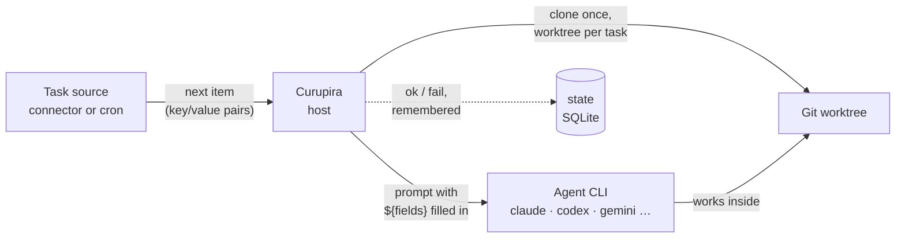

# How it works

Curupira is one Rust program that runs on your machine. It asks *task sources* for work,
prepares a Git checkout for each task, and starts the *coding-agent CLI* you chose with a
prompt built from the task. Nothing is hosted, and no service calls your machine.

## One task, start to finish { #lifecycle }

1. **Poll.** For each automation, Curupira asks its trigger for the next item. A connector
   returns one item (for GitHub, an issue, pull request, or board card) as a flat list of
   fields; cron returns the occurrence that is due.
2. **Deduplicate.** The fields are hashed into the task identity. An identity that already
   finished is skipped, so the same item never runs twice.
3. **Prepare.** The repository is cloned once under `~/.curupira/workspaces/`. Each task
   gets its own worktree and branch (`curupira/<automation>/…`), so tasks never share
   files and your own checkout is never touched.
4. **Render.** The automation's prompt is filled with the task fields (`${issue_title}`,
   `${pr_number}`, …) and can use conditions and loops. `run --dry-run` stops here and
   prints it.
5. **Run.** Curupira starts the agent CLI non-interactively in the worktree and waits.
   Up to `max_active_tasks` tasks run at the same time.
6. **Finish.** The result is stored, the worktree is removed, and `run` prints
   `ok` or `fail` with the task identity. Interrupted sessions resume after a restart.

## The pieces you configure { #glossary }

Everything lives in `~/.curupira/settings.toml`. These are the names you will see across
the documentation:

Repository
:   A Git remote the agent works in, declared under `[repositories.<alias>]`. Curupira
    clones it; it is not the GitHub repository being watched (that is the trigger's
    `repo` filter), although it usually points to the same place.

Agent profile
:   A named way to run one coding agent (`[agents.profiles.<name>]`): the `provider`
    (`claude`, `codex`, …) plus options such as `model` or `effort`. See
    [Coding agents](providers.md).

Plugin
:   A package of task sources registered under `[plugins.<alias>]`, started with `uvx`
    or `npx`. A plugin for one tool, such as GitHub, is called a connector; see
    [Plugins and connectors](plugins.md).

Trigger
:   One task source, addressed as `<alias>/<trigger>` (for example
    `plugins-py/github-issues`) or the built-in `cron`.

Automation
:   The rule that ties it together (`[automations.<name>]`): a trigger with its filters,
    the repository to work in, the agent profile, and the prompt. See
    [Automations](automations.md).

Task
:   One item an automation found, such as issue #128. It has an identity, a worktree, a
    prompt, and one agent run.

## Who does what { #boundaries }

| Curupira (the Rust host) | Plugins (task sources) | Agent CLIs |
| --- | --- | --- |
| Reads and validates the TOML | Find the next item | Read the prompt |
| Polls triggers and deduplicates tasks | Validate their own filters | Change code in the worktree |
| Clones, creates worktrees, runs `setup_script` | Hear when a task starts and finishes | Use their own login and settings |
| Renders the prompt and starts the agent | Never touch Git or the agent | Never talk to the plugins |
| Stores state and resumes sessions | | |

Plugins are separate processes that speak a small [JSON-RPC protocol](extensions-protocol.md)
over stdin and stdout. Coding agents are built into the host, so supporting a new agent is
a change to Curupira, not a plugin. To write your own task source, see
[Build extensions](extensions.md).

## Files on disk { #files }

| Path | What it holds |
| --- | --- |
| `~/.curupira/settings.toml` | Your configuration |
| `~/.curupira/workspaces/` | Clones and per-task worktrees (`workspace_dir`) |
| `~/.curupira/state.sqlite3` | Cron occurrences and resumable agent sessions (`state_db_path`) |
| `~/.curupira/dispatch.lock` | Held by the one process that is dispatching |
