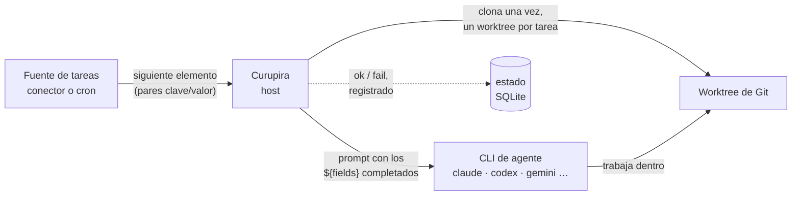

# Cómo funciona

Curupira es un único programa en Rust que se ejecuta en tu máquina. Pide trabajo a las
*fuentes de tareas*, prepara un checkout de Git para cada tarea e inicia la *CLI de agente
de código* que elegiste con un prompt construido a partir de la tarea. Nada se aloja en un
servidor y ningún servicio llama a tu máquina.

## Una tarea, de principio a fin { #lifecycle }

1. **Consulta.** Para cada automatización, Curupira pide a su trigger el siguiente
   elemento. Un conector devuelve
   un elemento (en GitHub, una issue, un pull request o una tarjeta de tablero) como una
   lista plana de campos; cron devuelve la ocurrencia que vence.
2. **Deduplica.** Los campos se convierten en un hash que forma la identidad de la tarea.
   Una identidad que ya terminó se omite, así que el mismo elemento nunca se ejecuta dos veces.
3. **Prepara.** El repositorio se clona una vez en `~/.curupira/workspaces/`. Cada tarea
   recibe su propio worktree y su rama (`curupira/<automation>/…`), así que las tareas
   nunca comparten archivos y tu propio checkout nunca se toca.
4. **Renderiza.** El prompt de la automatización se completa con los campos de la tarea
   (`${issue_title}`, `${pr_number}`, …) y puede usar condiciones y bucles. `run --dry-run`
   se detiene aquí y lo imprime.
5. **Ejecuta.** Curupira inicia la CLI del agente en modo no interactivo dentro del
   worktree y espera. Hasta `max_active_tasks` tareas se ejecutan al mismo tiempo.
6. **Termina.** El resultado se guarda, el worktree se elimina y `run` imprime `ok` o
   `fail` con la identidad de la tarea. Las sesiones interrumpidas se reanudan después de
   reiniciar.

## Las piezas que configuras { #glossary }

Todo vive en `~/.curupira/settings.toml`. Estos son los nombres que verás en toda la
documentación:

Repositorio
:   Un remoto de Git donde trabaja el agente, declarado en `[repositories.<alias>]`.
    Curupira lo clona; no es el repositorio de GitHub que se vigila (ese es el filtro
    `repo` del trigger), aunque normalmente apunta al mismo lugar.

Perfil de agente
:   Una forma con nombre de ejecutar un agente de código (`[agents.profiles.<name>]`): el
    `provider` (`claude`, `codex`, …) más opciones como `model` o `effort`. Consulta
    [Agentes de código](providers.md).

Plugin
:   Un paquete de fuentes de tareas registrado en `[plugins.<alias>]`, iniciado con `uvx`
    o `npx`. Un plugin para una herramienta, como GitHub, se llama conector; consulta
    [Plugins y conectores](plugins.md).

Trigger
:   Una fuente de tareas, referida como `<alias>/<trigger>` (por ejemplo
    `plugins-py/github-issues`) o el `cron` integrado.

Automatización
:   La regla que lo une todo (`[automations.<name>]`): un trigger con sus filtros, el
    repositorio donde trabajar, el perfil de agente y el prompt. Consulta
    [Automatizaciones](automations.md).

Tarea
:   Un elemento que encontró una automatización, como la issue #128. Tiene una identidad,
    un worktree, un prompt y una ejecución del agente.

## Quién hace qué { #boundaries }

| Curupira (el host en Rust) | Plugins (fuentes de tareas) | CLI de agentes |
| --- | --- | --- |
| Lee y valida el TOML | Encuentran el siguiente elemento | Leen el prompt |
| Consulta los triggers y deduplica las tareas | Validan sus propios filtros | Cambian el código en el worktree |
| Clona, crea worktrees, ejecuta `setup_script` | Reciben avisos cuando una tarea empieza y termina | Usan su propio inicio de sesión y sus ajustes |
| Renderiza el prompt e inicia el agente | Nunca tocan Git ni el agente | Nunca hablan con los plugins |
| Guarda el estado y reanuda sesiones | | |

Los plugins son procesos separados que hablan un pequeño [protocolo JSON-RPC](extensions-protocol.md)
por stdin y stdout. Los agentes de código están integrados en el host, así que dar soporte
a un agente nuevo es un cambio en Curupira, no un plugin. Para escribir tu propia fuente de
tareas, consulta [Desarrollar extensiones](extensions.md).

## Archivos en disco { #files }

| Ruta | Qué contiene |
| --- | --- |
| `~/.curupira/settings.toml` | Tu configuración |
| `~/.curupira/workspaces/` | Clones y worktrees por tarea (`workspace_dir`) |
| `~/.curupira/state.sqlite3` | Ocurrencias de cron y sesiones reanudables del agente (`state_db_path`) |
| `~/.curupira/dispatch.lock` | Lo mantiene el único proceso que está despachando |
