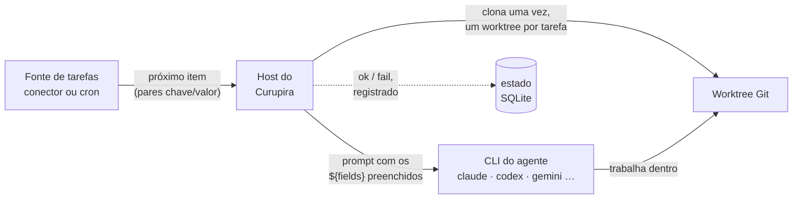

# Como funciona

O Curupira é um único programa em Rust que roda na sua máquina. Ele pede trabalho a *fontes de tarefas*,
prepara um checkout Git para cada tarefa e inicia a *CLI de agente de código* que você escolheu com um
prompt montado a partir da tarefa. Nada é hospedado, e nenhum serviço chama a sua máquina.

## Uma tarefa, do início ao fim { #lifecycle }

1. **Consulta.** Para cada automação, o Curupira pede ao trigger dela o próximo item. Um conector
   retorna um item (no GitHub, uma issue, um pull request ou um card do board) como uma lista plana de
   campos; o cron retorna a ocorrência que está vencida.
2. **Deduplicação.** Os campos geram um hash que vira a identidade da tarefa. Uma identidade que já
   terminou é ignorada, então o mesmo item nunca roda duas vezes.
3. **Preparação.** O repositório é clonado uma vez em `~/.curupira/workspaces/`. Cada tarefa
   recebe o seu próprio worktree e branch (`curupira/<automation>/…`), então as tarefas nunca compartilham
   arquivos e o seu próprio checkout nunca é tocado.
4. **Renderização.** O prompt da automação é preenchido com os campos da tarefa (`${issue_title}`,
   `${pr_number}`, …) e pode usar condições e loops. `run --dry-run` para aqui e
   o imprime.
5. **Execução.** O Curupira inicia a CLI do agente de forma não interativa no worktree e espera.
   Até `max_active_tasks` tarefas rodam ao mesmo tempo.
6. **Conclusão.** O resultado é armazenado, o worktree é removido e `run` imprime
   `ok` ou `fail` com a identidade da tarefa. Sessões interrompidas são retomadas após um reinício.

## As peças que você configura { #glossary }

Tudo fica em `~/.curupira/settings.toml`. Estes são os nomes que você verá ao longo
da documentação:

Repositório
:   Um remote Git em que o agente trabalha, declarado em `[repositories.<alias>]`. O Curupira
    o clona; ele não é o repositório do GitHub observado (esse é o filtro `repo` do
    trigger), embora normalmente aponte para o mesmo lugar.

Perfil de agente
:   Uma forma nomeada de executar um agente de código (`[agents.profiles.<name>]`): o `provider`
    (`claude`, `codex`, …) mais opções como `model` ou `effort`. Veja
    [Agentes de código](providers.md).

Plugin
:   Um pacote de fontes de tarefas registrado em `[plugins.<alias>]`, iniciado com `uvx`
    ou `npx`. Um plugin para uma ferramenta, como o GitHub, é chamado de conector; veja
    [Plugins e conectores](plugins.md).

Trigger
:   Uma fonte de tarefas, endereçada como `<alias>/<trigger>` (por exemplo
    `plugins-py/github-issues`) ou o `cron` embutido.

Automação
:   A regra que junta tudo (`[automations.<name>]`): um trigger com os seus filtros,
    o repositório em que trabalhar, o perfil de agente e o prompt. Veja
    [Automações](automations.md).

Tarefa
:   Um item que uma automação encontrou, como a issue #128. Ela tem uma identidade, um worktree, um
    prompt e uma execução do agente.

## Quem faz o quê { #boundaries }

| Curupira (o host em Rust) | Plugins (fontes de tarefas) | CLIs de agente |
| --- | --- | --- |
| Lê e valida o TOML | Encontram o próximo item | Leem o prompt |
| Consulta os triggers e deduplica tarefas | Validam os próprios filtros | Alteram o código no worktree |
| Clona, cria worktrees, executa o `setup_script` | São avisados quando uma tarefa começa e termina | Usam o próprio login e as próprias configurações |
| Renderiza o prompt e inicia o agente | Nunca tocam no Git nem no agente | Nunca conversam com os plugins |
| Armazena o estado e retoma sessões | | |

Plugins são processos separados que falam um pequeno [protocolo JSON-RPC](extensions-protocol.md)
por stdin e stdout. Os agentes de código são embutidos no host, então suportar um novo agente é
uma mudança no Curupira, não um plugin. Para escrever a sua própria fonte de tarefas, veja
[Desenvolver extensões](extensions.md).

## Arquivos em disco { #files }

| Caminho | O que contém |
| --- | --- |
| `~/.curupira/settings.toml` | A sua configuração |
| `~/.curupira/workspaces/` | Clones e worktrees por tarefa (`workspace_dir`) |
| `~/.curupira/state.sqlite3` | Ocorrências do cron e sessões retomáveis do agente (`state_db_path`) |
| `~/.curupira/dispatch.lock` | Mantido pelo único processo que está despachando |
